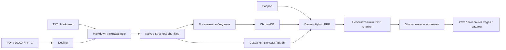

# Локальный RAG-сервис и модуль экспериментов


Сервис отвечает на вопросы по локальному корпусу учебных материалов. Документы,
запросы, контексты и эмбеддинги обрабатываются внутри локального контура.
Подготовка зависимостей и весов выполняется отдельно на машине с интернетом.

## Архитектура



FastAPI и CLI используют один `LocalRAGPipeline`. Гибридный поиск объединяет
плотный поиск с BM25 через reciprocal rank fusion. Генерация дополнительных
поисковых запросов отключена (`num_queries=1`). Реранкер получает до 15
кандидатов; если корпус меньше, используются все доступные кандидаты.

```text
local_rag_service/
  app/
    config.py          конфигурация и разрешённые локальные адреса
    schemas.py         контракты API
    ingestion.py       конвертация и чанкинг
    rag_engine.py      индексы, поиск, генерация, журналирование
    evaluation.py      локальный судья и метрики Ragas
    storage.py         атомарная запись и контрольные суммы
    main.py            приложение FastAPI
  data/
    raw/               исходные документы
    processed_md/      Markdown
    test_questions.csv вопросы и ответы с указанием статуса проверки
    indexes/           манифесты и сохранённые узлы, создаются при запуске
    chroma_db/         локальные коллекции, создаются при запуске
  models/              подготовленные веса, не входят в репозиторий
  results/             измерения, контрольные точки и plots/
  logs/                queries.jsonl
  tests/               автоматические проверки без загрузки моделей
  experiments.py       CLI четырёх экспериментов
  prepare_models.py    подготовка и проверка весов
  pyproject.toml
  uv.lock
  requirements.txt
  .env.example
```

## Окружение и установка

Целевая версия Python — 3.13. Проверки разработки выполняются на macOS arm64;
серверная конфигурация Linux/NVIDIA выбирается перед развёртыванием. Сборку
PyTorch/CUDA необходимо согласовать с драйвером сервера. CPU поддерживается,
но большие LLM и PDF-парсинг могут работать значительно медленнее.

Предварительный ориентир для полного набора моделей: 64 ГБ RAM, не менее 80 ГБ
свободного диска, GPU с 24–48 ГБ VRAM. Это не гарантированный минимум:
потребление зависит от квантизации, длины контекста, числа загруженных моделей
и размера документов. Модель 32B, эмбеддинги, реранкер и KV-кэш делят доступную
память. Точные требования следует измерить на выбранном сервере. Не нужно
загружать все четыре LLM в память одновременно.

Установка из зафиксированного окружения:

Команды `uv` предполагают установленный менеджер uv. Если его нет, используйте
приведённый ниже вариант установки через pip.

```bash
cd local_rag_service
uv sync --frozen --python 3.13
cp .env.example .env
```

Альтернатива через pip:

```bash
python3.13 -m venv .venv
source .venv/bin/activate
python -m pip install -r requirements.txt
```

`uv.lock` фиксирует прямые и транзитивные зависимости. `requirements.txt`
экспортируется из него с хешами:

```bash
uv export --frozen --no-dev --no-emit-project -o requirements.txt
```

Исключение из правила последних версий: `langchain-community<0.4.2` согласовано
из-за импорта удалённого `chat_models.vertexai` в Ragas 0.4.3. Остальные версии
выбраны решателем зависимостей и записаны в lock-файл. Облачные SDK могут быть
транзитивными зависимостями Ragas; приложение не создаёт их клиентов.
Судья обращается прямо к локальному `/api/chat` Ollama с JSON Schema.

## Подготовка моделей онлайн

```bash
uv run --frozen python prepare_models.py
ollama pull qwen3.5:9b
```

Скрипт скачивает BGE-M3, E5, BGE reranker и модели Docling. Он разрешает
ревизии Hugging Face в commit SHA и записывает контрольные суммы файлов в
`models/manifest.json`. Можно явно указать ревизию:

```bash
uv run --frozen python prepare_models.py --revision BAAI/bge-m3=COMMIT_SHA
```

Веса Ollama переносятся отдельно вместе с его каталогом моделей и манифестами;
на принимающем сервере следует указать `OLLAMA_MODELS` и проверить `ollama list`.
Не переносите только файлы GGUF без необходимых манифестов Ollama.

Для OCR сканированных PDF установите Tesseract с языковыми данными `rus` и `eng`,
затем задайте `OCR_ENABLED=true`. Например, на Debian/Ubuntu:

```bash
sudo apt-get install tesseract-ocr tesseract-ocr-rus tesseract-ocr-eng
```

Docling восстанавливает структуру PDF, DOCX и PPTX; точность формул, таблиц и OCR
необходимо проверить на реальных материалах. TXT и MD читаются непосредственно
как UTF-8, поскольку повторная конвертация уже текстовых файлов не нужна.

## Перенос в закрытый контур

На машине подготовки с той же ОС/архитектурой и Python, что и на сервере:

```bash
python -m pip download --only-binary=:all: -r requirements.txt -d wheelhouse
```

Перенесите исходный проект, Python/его установщик, `wheelhouse`, `models`,
артефакты Ollama и, при необходимости, Tesseract с языковыми данными. Не копируйте
macOS virtualenv на Linux. В закрытом контуре:

```bash
python3.13 -m venv .venv
source .venv/bin/activate
python -m pip install --no-index --find-links wheelhouse -r requirements.txt
python prepare_models.py --verify
```

При импорте приложения принудительно включаются offline-флаги Hugging Face,
отключаются телеметрия Ragas/Chroma и трассировка LangChain. Модели загружаются
по локальным путям. Адрес Ollama ограничен localhost или частным IP; HTTP-клиенты
не используют proxy из переменных окружения. Для строгой проверки на сервере
запретите исходящий внешний трафик средствами инфраструктуры, сохранив доступ
к локальному Ollama, и повторите ingestion и запрос.

## Конфигурация и запуск

Параметры читаются из `.env` и переменных окружения. Относительные пути считаются
от каталога проекта независимо от текущей рабочей директории.

| Параметр | Назначение |
| --- | --- |
| `DEVICE` | `cpu`, `cuda`, `cuda:0` или `mps` для эмбеддингов и реранкера |
| `MODEL_DIR` | локальные веса и их манифест |
| `EMBED_BATCH_SIZE` | размер батча эмбеддингов |
| `OLLAMA_BASE_URL` | по умолчанию `http://localhost:11434` |
| `OLLAMA_NUM_CTX` | контекст Ollama, по умолчанию 32768 |
| `OLLAMA_NUM_PREDICT` | максимум выходных токенов, по умолчанию 2048 |
| `OLLAMA_TIMEOUT` | тайм-аут модели, по умолчанию 120 секунд |
| `OLLAMA_KEEP_ALIVE` | время сохранения модели в памяти |
| `OCR_ENABLED` | включение OCR PDF |
| `REQUIRE_OLLAMA_ON_STARTUP` | завершать запуск при недоступности Ollama |

```bash
OLLAMA_NO_CLOUD=1 ollama serve
uv run --frozen uvicorn app.main:app --host 0.0.0.0 --port 8000 --workers 1
```

Если Ollama уже запущен, повторный `ollama serve` не нужен. Команда
`uv run --frozen python -m app.main` использует `HOST` и `PORT` из `.env`.
Для удалённой разработки можно открыть каталог на сервере через VS Code Remote SSH.

Для закрытого контура отключите облачные функции именно в процессе Ollama:
`OLLAMA_NO_CLOUD=1` или `disable_ollama_cloud: true` в его конфигурации с перезапуском
демона. Приложение дополнительно проверяет `remote_host`/`remote_model` через
`/api/show` перед отправкой текста. Настройка демона описана в
[официальном FAQ Ollama](https://github.com/ollama/ollama/blob/main/docs/faq.mdx).

Сервис рассчитан на один процесс Uvicorn: тяжёлые операции сериализованы
потоковой и файловой блокировкой. Это ограничивает конкуренцию за GPU и защищает
индексацию. Несколько процессов будут держать отдельные копии моделей в памяти.

## API

Поместите документы в `data/raw`. Подкаталоги разрешены; имя источника в ответе
и CSV — относительный POSIX-путь, например `module1/lecture_03.pdf`.

Поддерживаются `.pdf`, `.docx`, `.pptx`, `.txt` и `.md` (регистр расширения не важен).
Для презентаций извлекаются текст и таблицы слайдов. Текст внутри изображений
и сложные графические схемы требуют отдельной проверки: OCR PDF не включает OCR
изображений в PPTX. В экспертном CSV можно указать `expected_source_doc=lecture.pptx`.

```bash
curl -X POST http://localhost:8000/ingest \
  -H 'Content-Type: application/json' \
  -d '{"chunk_strategy":"structural","chunk_size":512,"chunk_overlap":64,"embedding_model":"BAAI/bge-m3"}'

curl -X POST http://localhost:8000/rag \
  -H 'Content-Type: application/json' \
  -d '{"question":"Как определяется градиент функции?","llm_model":"qwen3.5:9b","embedding_model":"BAAI/bge-m3","chunk_strategy":"structural","chunk_size":512,"chunk_overlap":64,"retrieval_mode":"hybrid_rerank","top_k":3,"temperature":0.1}'

curl -X POST http://localhost:8000/generate \
  -H 'Content-Type: application/json' \
  -d '{"prompt":"Объясни понятие градиента функции.","model":"qwen3.5:9b","temperature":0.1}'

curl http://localhost:8000/models
curl http://localhost:8000/health
```

`/ingest` выполняется синхронно; для больших корпусов увеличьте тайм-аут клиента.
`/health` возвращает 503 при недоступности Ollama или отсутствии базовых моделей,
200 при готовности, а также сведения о RAM, CPU и CUDA. Проверка наличия весов
не заменяет реальный тест инференса. `/models` показывает установленные LLM
и обнаруженные локальные эмбеддинги. OpenAPI доступен по `/docs`.

Ошибки валидации возвращают 422, отсутствие индекса/локальных весов — 409,
недоступность Ollama — 503, тайм-аут — 504, ошибка Ollama — 502.
Запрос к индексу требует совпадения embedding model, strategy, size и overlap.

`sources[0]` соответствует ссылке `[S1]`, далее аналогично. Ответ содержит
`citation_warnings` при неизвестной ссылке, отсутствии ссылок или недословной
цитате. Проверки не являются доказательством фактической корректности ответа.

## Семантика индекса и чанкинга

- Имена коллекций включают модель, стратегию, размер, overlap и версию сборки.
  Активный манифест переключается атомарно только после сохранения коллекции и узлов.
- Повторный ingestion пересобирает активный снимок корпуса. Удалённые исходники
  исчезают из нового индекса. Предыдущие версии сохраняются для воспроизводимости;
  их удаление выполняется отдельно после проверки отсутствия ссылок в результатах.
- Узлы и их контрольная сумма сохраняются на диск; BM25 восстанавливается из них.
- Для обеих моделей используется единый токенизатор E5. `chunk_size` лежит в
  диапазоне 64–512; 16 токенов зарезервированы под префиксы и служебные токены.
  Реальный размер текста меньше номинального. E5 получает `query: ` / `passage: `.
- Structural сохраняет путь заголовков в каждом фрагменте. Таблицы отделяются
  от прозы и режутся по строкам с повторением заголовка. Если одна строка таблицы
  не помещается в лимит, ingestion завершается с явной ошибкой, без усечения.
- Слишком длинный вопрос отклоняется до поиска. Бюджет генерации проверяется
  консервативно по UTF-8-байтам; при ошибке увеличьте контекст Ollama либо уменьшите
  число/размер фрагментов. Тихое усечение контекста не используется приложением.

## Данные экспериментов

`data/test_questions.csv` содержит четыре обязательных столбца:

```csv
question_id,question,ground_truth_answer,expected_source_doc
```

Каждая строка должна содержать уникальный идентификатор, учебный вопрос,
эталонный ответ и точное имя исходного файла относительно `data/raw`.
Файл читается в UTF-8; поля с запятыми и переводами строк заключаются в кавычки
по правилам CSV. Пустые значения и повторяющиеся идентификаторы отклоняются.
Подготовлено 90 вопросов по 15 PDF (по 6 на документ). Статус
`expert_confirmed_user_reported` означает, что пользователь сообщил о проверке
подготовленных ИИ ответов с преподавателями. Имена и дата проверки не сообщены;
поля `expert_reviewer` и `expert_reviewed_at` оставлены пустыми. Статусы переносятся
в результаты экспериментов. Страницы, подтверждающий текст и SHA-256 PDF
сохранены в `data/test_questions.evidence.csv`; удобная версия —
`data/QUESTIONS_DRAFT.md`. Это пилотный набор преимущественно прямых вопросов.

## Запуск экспериментов

```bash
uv run --frozen python experiments.py --experiment all --repeats 3
uv run --frozen python experiments.py --experiment exp1 --repeats 3 --output-dir results/exp1
uv run --frozen python experiments.py --experiment exp2 --data-path data/test_questions.csv --output-dir results/exp2
uv run --frozen python experiments.py --experiment exp3 --output-dir results/exp3
uv run --frozen python experiments.py --experiment exp4 --output-dir results/exp4
```

| Аргумент | Назначение |
| --- | --- |
| `--data-path` | CSV с вопросами и эталонами |
| `--output-dir` | отдельный каталог прогона |
| `--repeats` | число повторов, по умолчанию 3 |
| `--experiment` | `all`, `exp1`, `exp2`, `exp3`, `exp4` |
| `--phase` | `all`, `generate` или `evaluate` |
| `--temperature` | температура исследуемых моделей, по умолчанию 0.1 |
| `--resume` | продолжить прерванный прогон с совпадающими входами и окружением |
| `--warmup` / `--no-warmup` | включить/отключить отдельный прогрев каждой конфигурации |

В полном режиме сначала собираются ответы всех конфигураций, затем работает
судья. Это отделяет оценку от замера задержек исследуемых моделей. Для отдельных фаз:

```bash
uv run --frozen python experiments.py --phase generate --output-dir results/run1
uv run --frozen python experiments.py --phase evaluate --resume --output-dir results/run1
```

При продолжении используйте те же аргументы выбора эксперимента, повторов,
температуры и прогрева. Манифест фиксирует входы, версии пакетов, код, настройки
и подготовленные веса, а также digest, квантизацию и версию Ollama. Изменение входов
требует нового каталога результатов. Версии индексов закреплены в
`index_versions.json`; их замена при продолжении прогона отклоняется. Файловая
блокировка исключает два одновременных прогона в одном каталоге результатов.
Контрольная точка записывается атомарно после каждого вопроса; ошибки инференса
и оценки сохраняются отдельно и повторяются при `--resume`.

Всего предусмотрено 25 конфигураций: 4 + 5 + 12 + 4. В эксперименте 3 фиксирован
`structural_512 / hybrid_rerank_15_to_3 / bge-m3`. Выбор победителя по той же
тестовой выборке не выполняется.

Методические ограничения:

- Эксперимент 1 проверяет гипотезу о чанкинге; обе стратегии используют один
  результат конвертации Docling, поэтому он не сравнивает разные PDF-парсеры.
- Релевантность retrieval определяется совпадением исходного документа.
  MRR ограничен возвращённой выдачей; он не оценивает ранг во всём корпусе.
- Hit Rate@5 при выдаче короче пяти фрагментов — N/A. Аналогично для Hit Rate@3.
- Faithfulness у direct — N/A: контекст ему не предоставляется. Эта метрика
  не доказывает подавление галлюцинаций в сравнении с direct. Для такого вывода
  нужна отдельная согласованная оценка по эталонным материалам.
- Semantic Similarity — косинус BGE-M3 между ответом и эталоном.
  Answer Relevance рассчитывается Ragas с локальным судьёй и эмбеддингами.
- Судья задаётся через `JUDGE_MODEL` (по умолчанию `gemma4:31b`), temperature=0. Он может предпочитать ответы
  собственной модели; результаты нуждаются в экспертной выборочной проверке.
- Одинаковый seed и temperature=0 не гарантируют побитовую повторяемость GPU.
  `think`-блоки моделей удаляются перед оценкой; исходный direct-ответ сохраняется.
- Retrieval latency включает поиск и реранкинг; его время также записано отдельно.
  На холодном запросе оно включает загрузку ресурсов. Прогрев исключён из CSV.
  Время судьи не входит в end-to-end latency RAG. `rss_bytes` — текущая RSS
  процесса Python, а не пиковая память и не память отдельного процесса Ollama.

Результаты:

- `evaluation_results_raw.csv`: ответы, источники, параметры и измерения по вопросам;
- `summary_metrics.csv`: среднее, медиана, число доступных измерений каждой метрики;
- `run_manifest.json` и `checkpoints/`: воспроизводимость и продолжение;
- `plots/exp1_chunking_strategy.png`;
- `plots/exp2_retrieval_comparison.png`;
- `plots/exp3_rag_vs_raw_llm.png`;
- `plots/exp4_embeddings_benchmark.png`.

Графики сохраняются в 300 DPI. Для одиночного эксперимента создаётся только
его график. Пропущенные метрики не заменяются нулями. Неуспешные прогоны приводят
к ненулевому коду завершения, сохраняя уже полученные результаты.

## Проверки

```bash
uv run --frozen pytest -q
uv run --frozen ruff check .
uv run --frozen ruff format --check .
```

Автоматические тесты запрещают сетевые соединения, используют настоящую
персистентную ChromaDB и BM25. Большинство тестов заменяет инференс тестовыми
объектами; отдельный тест проходит через HuggingFaceEmbedding и реранкер на
маленьких случайных весах, созданных локально исключительно для проверки API.
Они проверяют структуру чанков, восстановление индексов, повторный ingestion,
атомарное переключение, формулы метрик и контракты API. Реальный прогон на
целевых весах и учебном корпусе требуется отдельно; тестовые результаты не
считаются научными измерениями. Фактически выполненные проверки перечислены
в [VALIDATION.md](VALIDATION.md).

## Модели и отдельные фазы

Реестр включает `qwen3.5:9b`, `qwen3.8:27b`, `gemma4:12b`, `gemma4:31b`,
`ministral-3:8b`, `ministral-3:14b`. Базовая модель — `qwen3.5:9b`.
Выбор описан в [MODEL_SELECTION.md](../MODEL_SELECTION.md). Их наличие в реестре
не означает, что все модели уже проверены на целевом GPU.

`--model` выбирает базовую модель exp1/exp2/exp4. `--models` ограничивает список
в exp3. Для ограничения расхода диска можно запускать модели по очереди,
сохраняя каждую в отдельный каталог результатов:

```bash
.venv/bin/python experiments.py --experiment exp3 --models qwen3.5:9b --repeats 1 --phase generate --output-dir results/qwen9b
JUDGE_MODEL=gemma4:31b .venv/bin/python experiments.py --experiment exp3 --models qwen3.5:9b --repeats 1 --phase evaluate --resume --output-dir results/qwen9b
```

Генерация требует только выбранные генераторы. Оценка использует сохранённые
ответы и требует модель-судью; генераторы можно удалить из Ollama после генерации.
Вес судьи и версия Ollama фиксируются в `evaluation_manifest.json`; смена судьи
для уже начатой оценки запрещена, чтобы не смешивать оценки разных моделей.
Параметры выбора конфигураций при оценке должны совпадать с генерацией.

На кластере ресурсы Slurm и сервер Ollama запускаются вручную. Команды Python
выполняются внутри выделенной вычислительной сессии. Для проверенного профиля
V100 используется `DEVICE=cpu` для PyTorch-компонентов и GPU через Ollama.
При таком профиле время поиска включает работу CPU; это необходимо указывать
в отчёте. Полный запуск всех LLM с их весами одновременно не требуется.

## Терминальный RAG

В папке сервиса при запущенной Ollama:

```bash
.venv/bin/python chat.py --model qwen3.5:9b --ollama-url http://127.0.0.1:18480
```

Для стандартного порта 11434 параметр --ollama-url можно опустить.
На кластере запускать чат и Ollama внутри выделенной Slurm-сессии.

- `/models` — установленные модели; `/model ИМЯ` — переключить генератор.
- `/ingest` — обработать весь корпус data/raw и перестроить индекс после изменения файлов.
- `/sources` — показать/скрыть текст найденных фрагментов.
- `/exit` — выход; `/help` — команды.

По умолчанию используется сохранённый индекс structural/512/overlap64/BGE-M3,
поиск hybrid_rerank. Повторная индексация выполняется только явно: /ingest или --ingest.
Вопросы независимы, память диалога отсутствует. Ollama загружает выбранную модель
при запросе; скачивание весов выполняется отдельно через ollama pull.
DEVICE=cpu задаёт CPU для Docling, эмбеддингов и reranker, не для Ollama.

Для одного ответа используйте --question "Ваш вопрос"; --sources показывает фрагменты.
